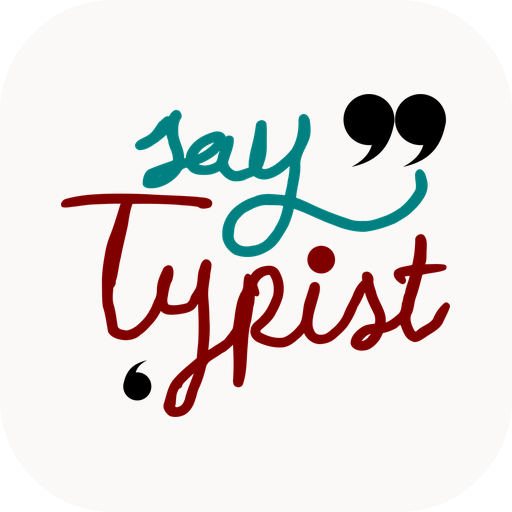

[](https://f-droid.org/en/packages/com.elishaazaria.sayboard/)


# sayTypist

**sayTypist** is a voice typing project built on [Vosk](https://alphacephei.com/vosk/android):
an Android keyboard (IME) and a desktop app for Windows and Linux, sharing the
same offline speech models.

It is a fork of [Sayboard](https://github.com/ElishaAz/Sayboard) by Elisha Azaria,
which itself is based on [vosk-android-demo](https://github.com/Felicis/vosk-android-demo).

This app requires a Vosk model to run. You can use the built-in downloader or download manually from
[https://alphacephei.com/vosk/models](https://alphacephei.com/vosk/models), and then import into the app.

## Platforms

| Platform | What you get | Where |
| --- | --- | --- |
| **Android** | the voice keyboard (IME), app name *sayTypist* | `app/` — the Gradle project in this repository |
| **Windows / Linux** | the desktop voice-typing app (Kotlin + Compose Desktop): global hotkey, text typed into any window, English/Persian UI, packaged as AppImage / .deb / .msi, and it tells you *in the window* which system tools still have to be installed | [`desktop/`](desktop/README.md) |

The Android project builds on any OS (Linux, Windows or macOS) with JDK 17 and an
Android SDK; `./gradlew assembleDebug` (Linux/macOS) or `gradlew.bat assembleDebug`
(Windows) produces the APKs.

The desktop app is a Kotlin/Compose Desktop program with its own GUI and the same
model catalog, so a fork can be used on a phone and on a computer with the same
models. It runs on Windows 10/11 (x64) and on glibc based x86_64 Linux
distributions — the AppImage is the portable option, `.deb`/`.rpm`/`.msi` are
also available. Linux ARM and musl (Alpine) are not supported by the official
Vosk JVM artifact; see [desktop/README.md](desktop/README.md#which-systems-work). It builds with the same Gradle wrapper:

```bash
./gradlew :desktop:run                     # run it
cd desktop && ./package-appimage.sh        # Linux AppImage (bundles Java)
./gradlew :desktop:packageDeb               # Linux .deb
gradlew.bat :desktop:packageMsi             # Windows installer
```

See [desktop/README.md](desktop/README.md) for details.

## Documentation

- [Desktop user guide (English)](docs/desktop-user-guide.md) ·
  [راهنمای فارسی](docs/desktop-user-guide.fa.md)
- [Building both apps, versioning, project layout](docs/building.md)
- [Third party components, licenses and the logo](docs/third-party.md)

## Links

- This project: <https://github.com/ssmns/Sayboard>
- Upstream project (Sayboard): <https://github.com/ElishaAz/Sayboard>
- Vosk speech engine: <https://alphacephei.com/vosk>
- Official model list: <https://alphacephei.com/vosk/models>
- License: [GNU GPL v3.0](LICENSE.txt)
- Version: [`version.properties`](version.properties) (currently **1.0.0**)

## Models

The built-in downloader offers the **whole official Vosk catalog**, not only the
lightweight "small" models:

- every model from <https://alphacephei.com/vosk/models> (small, medium and the
  big multi-gigabyte ones), grouped by language;
- each entry shows its download size, a lightweight/medium/large/very-large
  badge, the recommended RAM and its license;
- downloading a model that is not "small" asks for confirmation and shows how
  much disk space it needs (archive + extracted model) before it starts;
- downloads are resumable, so a dropped connection does not restart a 2 GB
  download, and the app refuses to start a download that cannot fit on the disk.

The catalog lives in [`catalog/vosk_models.json`](catalog/vosk_models.json).
Edit it and run `./gradlew :desktop:generateCatalog` to regenerate the Android
`ModelLink.kt` plus the desktop copy — both platforms then offer the same list.

Heavy models give noticeably better accuracy but need a lot of RAM (the big
English model needs several GB) and load slowly, especially on phones. Small
models (40–60 MB) are the safe default for mobile devices.

## Sharing models without the internet (Android)

Nobody has to download the same gigabyte twice. In the **Models** tab, press the
share button:

- **People next to you, on the same Wi-Fi/hotspot (no internet needed)**
  Turn on *“Share my models on this network”*. The app serves the installed
  models over the local network and answers a small discovery broadcast, so the
  other phone only has to press *“Scan the network”* (same dialog) and pick a
  model. It is copied straight into the models folder — no archive, no extra
  disk space, with progress and the usual notification. Both devices can share
  at the same time.
- **Nobody has a network at all**
  The share icon next to an installed model packs it into a `.zip` and opens the
  Android share sheet: Bluetooth, Nearby Share, a USB cable, a file manager on
  SD card, ... On the other phone, use the folder button (import) and pick the
  file. The zip keeps the language, so models with unusual names still import
  with the right locale.

The local sharing service only runs while the switch is on (it shows a
notification with a stop action), and it only serves the model folders of this
app to the local network — there is no authentication, so use it on networks you
trust.

## Permissions
sayTypist uses for the following permissions:
- INTERNET - to download the models. This permission is not required, and can be revoked through the device settings in compatible ROMs.
**sayTypist does not, and never will, send any of your information over the internet!**.
- RECORD_AUDIO - well, this is a voice keyboard after all.
- POST_NOTIFICATIONS - to show download and import progress.
- FOREGROUND_SERVICE - to download and import models in the background, and for the RecognitionService.
- FOREGROUND_SERVICE_MICROPHONE - for the RecognitionService.
- FOREGROUND_SERVICE_SPECIAL_USE - for the download service.
- QUERY_ALL_PACKAGES - do to bug in Android, this permission is required for a speech RecognitionService to work properly (see https://github.com/Kaljurand/K6nele-service/issues/9).

## Screenshot

Screenshot of sayTypist:

https://github.com/ElishaAz/Sayboard/assets/26592879/58f1421e-0e10-488f-a7fa-4aa702f1cee2

Note: prior to commit [Multiple language support!](https://github.com/ElishaAz/Sayboard/commit/9d61c774e6eb623c2b8603a85a5bd73d98ab9af1),
this repository had another gradle model named `models`. As it is large and not needed anymore, I removed it from git history.
If you want to use any earlier commits, you can find it [here](https://github.com/Felicis/vosk-android-demo/tree/master/models).
